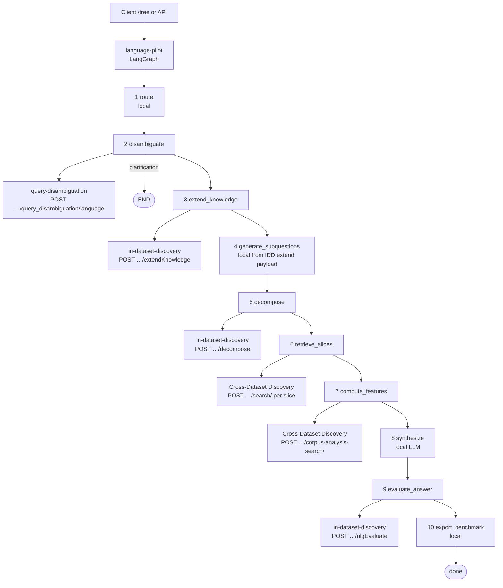

# UC4P2 Language Pilot — architecture

The **UC4P2 Language Pilot** (`language-pilot`) is the orchestration shell for DataGEMS Thematic Search (historical comparative QA). It does **not** own portable NLP tools: those live in shared services. The pilot runs a LangGraph pipeline, calls upstream HTTP APIs per step, streams progress to `/tree`, and packages a benchmark-shaped record at the end.

Live demo: `https://datagems-dev.scayle.es/language-pilot/tree`  
Curl catalog: [`API.md`](API.md) · Overview: [`README.md`](README.md)

---

## Services in the UC4P2 language path

| Role | Repo / service | Dev base URL |
|------|----------------|--------------|
| Orchestrator + UI | [UC4P2-Language-pilot](https://github.com/datagems-eosc/UC4P2-Language-pilot) | `https://datagems-dev.scayle.es/language-pilot` |
| Query disambiguation | [dg-query-disambiguation](https://github.com/datagems-eosc/dg-query-disambiguation) | `https://datagems-dev.scayle.es/query-disambiguation` |
| Question tools (extend / decompose / NLG) | [in-dataset-discovery](https://github.com/datagems-eosc/in-dataset-discovery) | `https://datagems-dev.scayle.es/in-dataset-discovery` |
| Retrieval + corpus features | Cross-Dataset Discovery | `https://datagems-dev.scayle.es/cross-dataset-discovery` (env `CROSS_DATASET_DISCOVERY_URL`) |
| Auth | DataGEMS AAI (Keycloak) | `…/oauth/realms/dev/protocol/openid-connect/token` |
| GitOps deploy | [UC4P2-Language-pilot-deployment-dev](https://github.com/datagems-eosc/UC4P2-Language-pilot-deployment-dev) | image bump on `main` |

Auth for protected POSTs: `Authorization: Bearer <access_token>` (scope `openid datagems offline_access`), same contract as dg-app-api.

---

## Pipeline (step → API)

Entry points on the pilot:

- `POST /ThematicExploration` — full run  
- `POST /ThematicExploration/stream` — SSE one event per finished step (`/tree` uses this)  
- `POST /steps/<name>` — run from the start through that node  

### Step map

| # | LangGraph node | Pilot step API | Upstream call | Fallback if remote fails |
|---|----------------|----------------|---------------|--------------------------|
| 1 | `route` | `POST /steps/route` | *(none — local router)* | — |
| 2 | `disambiguate` | `POST /steps/disambiguate` | **QD** `POST /query_disambiguation/language` | Local comparative gate / slices |
| 3 | `extend_knowledge` | `POST /steps/extend-knowledge` | **IDD** `POST /extendKnowledge` (when `USE_IN_DATASET_DISCOVERY`) | Local knowledge-extension expander |
| 4 | `generate_subquestions` | `POST /steps/generate-subquestions` | *(none — maps IDD extend facets/lemmas, or local)* | Local sub-question builder |
| 5 | `decompose` | `POST /steps/decompose` | **IDD** `POST /decompose` | Local QDMR / DSPy (`decompose_mode`: `few-shot` / `cot` / `predict`) |
| 6 | `retrieve_slices` | `POST /steps/retrieve` | **CDD** `POST /search/` once per comparison slice | Error recorded; no substitute search service |
| 7 | `compute_features` | `POST /steps/features` | **CDD** `POST /corpus-analysis-search/` | Soft-fail → local KWIC / collocations on passages |
| 8 | `synthesize` | `POST /steps/synthesize` | *(none — local LLM over `passages`)* | — |
| 9 | `evaluate_answer` | `POST /steps/evaluate` | **IDD** `POST /nlgEvaluate` | Local NLG metrics vs pilot `data/pilot2_benchmark_english.v2.json` |
| 10 | `export_benchmark` | `POST /steps/export` | *(none — serialize run record)* | — |

Full gateway URLs on Scayle (dev):

| Upstream | Method + path |
|----------|----------------|
| Query disambiguation | `POST https://datagems-dev.scayle.es/query-disambiguation/query_disambiguation/language` |
| In-dataset discovery | `POST https://datagems-dev.scayle.es/in-dataset-discovery/extendKnowledge` |
| | `POST https://datagems-dev.scayle.es/in-dataset-discovery/decompose` |
| | `POST https://datagems-dev.scayle.es/in-dataset-discovery/nlgEvaluate` |
| Cross-Dataset Discovery | `POST {CROSS_DATASET_DISCOVERY_URL}/search/` |
| | `POST {CROSS_DATASET_DISCOVERY_URL}/corpus-analysis-search/` |

---

## What each remote call does

| Call | Consumed by | Purpose |
|------|-------------|---------|
| QD `/query_disambiguation/language` | `disambiguate` | Temporal / descriptive slices, concept, `comparison_type`, archive proceed/reject |
| IDD `/extendKnowledge` | `extend_knowledge` (+ feeds `generate_subquestions`) | Thematic facets, per-slice lemmas, optional extension questions |
| IDD `/decompose` | `decompose` | QDMR-style plan across comparison slices |
| CDD `/search/` | `retrieve_slices` | Hybrid search restricted to language corpora (EncycNet, KP, Diderot, Wikipedia) |
| CDD `/corpus-analysis-search/` | `compute_features` | Comparative corpus features (soft-fail OK) |
| IDD `/nlgEvaluate` | `evaluate_answer` | Exact gold match by `query_id` / question + NLG metrics |

Synthesis and routing stay inside the pilot. Citations in the answer are remapped to `[ref_N]` from retrieved passages only.

---

## Data ownership

| Asset | Where it lives | Used for |
|-------|----------------|----------|
| Full Pilot 2 v2 benchmark | **This repo** `data/pilot2_benchmark_english.v2.json` | Demo drawer (`GET /tree/questions`), few-shots, local NLG gold |
| Parent NLG gold only | **IDD** `data/nlg/pilot2_nlg_gold.v2.json` | Remote `/nlgEvaluate` when IDD is enabled |

The tree drawer lists **all** benchmark questions (`Question_ID` / `Subquestion_ID` `0`–`35`): parents plus nested `Subquestions`, grouped by concept.

---

## Config (env)

| Variable | Effect |
|----------|--------|
| `QUERY_DISAMBIGUATION_URL` | QD base (default Scayle query-disambiguation) |
| `USE_IN_DATASET_DISCOVERY` | `1`/`true` → IDD for extend / decompose / NLG |
| `IN_DATASET_DISCOVERY_URL` | IDD base |
| `CROSS_DATASET_DISCOVERY_URL` | CDD base |
| `DG_USERNAME` / `DG_PASSWORD` | OIDC password grant for outbound Bearer tokens |
| `*_TOKEN` | Optional static Bearer override per service |

GitOps image/tag: sibling repo `UC4P2-Language-pilot-deployment-dev` (push `main` only).

---

## Related docs

- [`API.md`](API.md) — curl examples for pilot, QD, IDD, and CDD  
- [`EXAMPLES.md`](EXAMPLES.md) — demo questions from the v2 benchmark  
- [`README.md`](README.md) — run locally, step endpoint table, corpora UUIDs  
